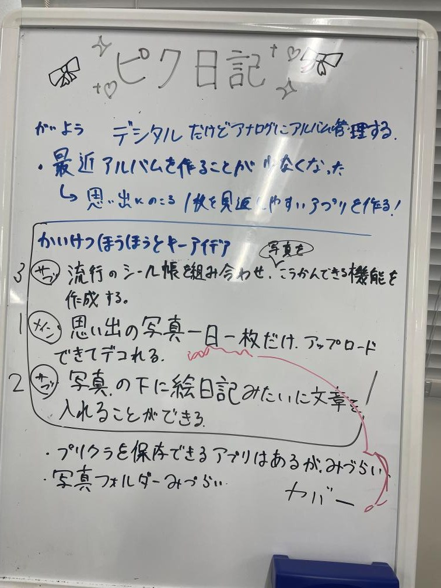
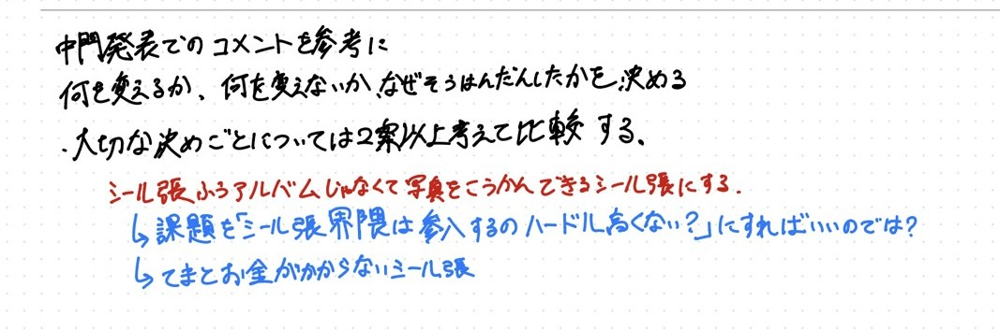

令和8年度 電子情報システム工学実験実習 BII　出席番号 4421　氏名 高野芽楓

# レポート1：Webアプリケーション開発の振り返り（1）

チーム名「美4」、プロダクト名「ピク日記」。本レポートでは、第1回（10/9）から第3回（10/23）までの開発を振り返る。リポジトリ上で Claude（生成AI）が書いた部分は、すべて私が指示し、確認したものである。グループの他のメンバーに Claude を使っている人はいない。

## 1. 前期の企画・設計の再検討

### 1.1 前期に決めていた企画・設計

前期の企画では、ターゲットをペルソナ法で「橘つむぎ（17歳、写真部）」とした。彼女はプリクラやチェキが好きなアナログ派で、毎日たくさん写真を撮るが、スマホの写真フォルダでは画像が並ぶだけで味気ないと感じている。そこで課題を「思い出の写真がパッと見返せない」と定め、成功の定義を「その日の思い出をかわいい形で保存でき、すぐに見返せること」とした。最低限完成させる機能は、写真の交換、写真のアップ、写真への落書き、写真1つにつき1つの文章の4つである。役割分担は、坂下さんがデザイン、私が落書き機能、日高さんが写真交換機能、藤井さんが写真アップ機能とした。

図1は、チームでアイデアを出したときのホワイトボードである。「デジタルだけどアナログにアルバムを管理する」を目的に、解決アイデアを優先順位つきで並べている。「流行のシール帳と組み合わせて、写真を交換できる機能を作る」「思い出の写真を一日一枚だけアップロードしてデコれる」「写真の下に絵日記のように文章を入れられる」の3つである。この図から、前期の時点では、シール帳のかわいさと写真の交換を中心に据えていたことが読み取れる。

{width=45%}

### 1.2 中間発表で得られた意見と、変更した点

中間発表では、11件の回答で、5項目の評価（3点満点）とコメントをもらった。表1は、その平均点である。

| 評価項目 | 平均点 | 3点の人数 | 2点の人数 | 1点の人数 |
|---|---|---|---|---|
| i. 利用者と課題が明確か | 2.64 | 7 | 4 | 0 |
| ii. 特徴・アプローチが課題解決につながっているか | 2.55 | 6 | 5 | 0 |
| iii. 主要機能が具体的に設計されているか | 2.45 | 6 | 4 | 1 |
| iv. 利用者に配慮した画面や操作か | 2.45 | 5 | 6 | 0 |
| v. 実装上の課題と今後の対応を説明できているか | 2.55 | 7 | 3 | 1 |

表1 中間発表の評価（回答11件）

どの項目も平均は2.5前後で、「概要は分かるが、一部が曖昧」とされた回答が多かった。特に iii と iv の平均が低く、機能の具体性と画面の配慮が弱いと受け取られたことが分かる。

私たちは、もともと「課題と解決策のつながりが浅いのではないか」という疑問をチーム内に持っていた。そのため、表1の項目 ii と、「シール帳風のアルバムではなく、写真を交換できるシール帳にしてはどうか」という意見を、企画を見直す機会とした。図2は、そのときに私が書いた検討メモである。「何を変えるか、何を変えないか、なぜそう判断したかを決める」「大切な決めごとは2案以上考えて比較する」という進め方を先に書き、そのうえで案を並べた。

{width=90%}

検討したのは、「今の課題のまま進める」案と、「課題を変える」案の2案である。課題を変える案では、課題を「シール帳界隈は参入するハードルが高くないか？」に置き換え、解決策を「手間とお金がかからないシール帳」にする。これにより、「写真を交換できる」という特徴が、課題の解決に直接つながる。もともと、課題と解決策のつながりが浅いという疑問が私たちの中にあったため、「課題を変える」案を可決し、採用した。今の課題のまま進める案は、その疑問が解消されないため、採用しなかった。

### 1.3 変更しなかった点

それ以外の意見（既存サービスとの差別化、写真の複数枚登録、印刷やスマホアプリ化など）については、検討したうえで、私たちの考えは変わらなかった。理由は、「友達と交換して思い出を残す」ことを前提に、不特定多数への公開や評価の仕組みは作らないと整理しており、差別化の方針をすでに決めていたためである。また、シール帳のように、一度上げたらなくなる不便さを、あえて残していた。

### 1.4 設計の見直し

後期の実装に進むにあたり、データベースの設計も見直した。最初は、キャラクター、ユーザー、ログイン状態、投稿の4つのテーブルだけだった。その後、友達機能と交換機能のために、友達申請、友達関係、交換する投稿の3つを足し、現在は7つのテーブルになっている。また、ユーザーには、ログイン用のメールアドレスに加えて、友達を検索するためのユーザーIDの列も足した。

## 2. 現在の進捗と課題・検討事項

### 2.1 完成していること

第3回までに、次の機能が動く状態になっている。新規登録とログイン（メールアドレスとパスワード）、4種類のキャラクターから選ぶキャラ選択、キャラを変えられるマイページ、友達機能（IDでの検索、申請、承認・拒否、一覧）、写真と日記本文の投稿、月ごとのカレンダー表示、友達と写真を交換する機能（送信側が申請し、受信側が承認・拒否する）、ログアウトである。ワークシートで決めた最低限の4機能のうち、写真のアップ、写真の交換、写真1つにつき1つの文章の3つは動いている。

写真1つにつき1つの文章は、投稿時に本文を必須にすることで実現している。写真の交換は、日高さんが実装した（コミット「交換機能」）。

### 2.2 完成していないことと、現在の課題

完成していないことは、次のとおりである。

- **写真への落書き機能。** 私の担当だが、リポジトリにはまだ入っていない。
- **一日一枚の制限。** 図1のアイデア出しでは優先順位1位だったが、最低限の機能には入れておらず、実装もしていない。
- 一日に複数枚の写真を登録し、カレンダーに表示する1枚を選ぶ機能。中間発表で要望があったが、開発に余裕ができたら入れるつもりである。
- アルバムの印刷とスマホアプリ化。今後の展望としている。

課題は2つある。1つ目は、公開の仕方である。本物の登録・ログインは、バックエンド（Express と MySQL）を自分のPCで動かして `http://localhost:3000/` で開いたときだけ使える。GitHub Pages には、静的なファイルしか置けないためである。2つ目は、動作確認の少なさである。自動テストはなく、画面を触って確かめているだけで、ほかのメンバーのPCでのデータベースを含めた確認は十分でない。

## 3. 課題・検討事項への対応とその結果

### 3.1 登録エラーの原因の見立てを訂正した件

10/16に、ログイン後と新規登録後のキャラ選択で「登録に失敗しました」というエラーが出た。最初、Claude は、手元のMySQLに古いスキーマの `users` テーブル（メールアドレスの列がない）が残っていることが原因だと推測した。コードと履歴を読んだだけの推測で、実際に動かして確かめてはいなかったので、Claude 自身もそう断っていた。それでも、起動時にテーブルを自動で移行する処理を追加した。

しかし、私が送ったスクリーンショットのアドレスは `pikunikki.github.io` だった。GitHub Pages にはバックエンドがなく、登録のAPI（`/api/register`）がそもそも存在しない。そのため、先の推測は外れていたことが分かった。Claude が見立てを訂正し、GitHub Pages で開いたときにはデモモードに切り替える修正に変更した（3.2）。このとき追加したテーブルの自動移行は、ローカルで古いデータベースを使う場合には有効なので、そのまま残した。

その後、本物の登録を試すために、私は自分のPCにMySQLを入れ、Claude の案内で手順1から4まで順に進めた。途中で `Access denied for user 'pikunikki'` というエラーが出た。サーバーは起動しており、登録のAPIまで届いている。エラーの原因は、`.env` のパスワードと、MySQLに設定したパスワードの不一致だった。直したあとは、写真を投稿できるところまで動いた。10/23には、友達のPCで「テーブルがない」というエラーが出た。こちらは、そのPCで `npm run db:init` が未実行であることが原因だと考えられ、実行する手順を案内した。この経験から、ローカルで動かす手順と、エラーごとの対処を `README.md` にまとめた。

この件から、エラーの原因は、画面に出たメッセージとアドレスで、どこで動いているかを確かめてから決めなければならない、と学んだ。

### 3.2 デモモードと本番モードの切り分け

10/9の最初の画面遷移のプロトタイプは、データをブラウザの `localStorage` だけに保存していた。その後、バックエンドを作って接続したが、友達が作った `login.html` と `signup.html` は、まだ `app.js` につながっておらず、ボタンを押しても次の画面に進めなかった。そこで、バックエンドなしでも画面遷移を確かめられるように、`app.js` の先頭に `DEMO_MODE` という切り替えを設けた。最初は、手で `true` か `false` に書き換える方式だった。しかし、これでは書き換え忘れが起こる。そこで10/16に、アドレスが `github.io` で終わるときだけ自動でデモモードになるように変えた。

その結果、GitHub Pages では登録からホームまで画面が動き、ローカルでは本物のデータベースを使う、という使い分けができた。ただし、デモモードのデータはブラウザの中にしか残らず、ほかの人とは共有されない。友達機能や交換機能は、デモモードでは確かめられない。

### 3.3 画像投稿が動かなくなった件の原因

10/23に、私が「画像の投稿ができなくなった」と報告した。Claude が再現したところ、投稿ボタンを押した瞬間に `submitButton is not defined` というエラーになり、何も送信されていなかった。原因は、`post.html` の投稿処理が `submitButton` という変数を使っているのに、その変数が定義されていなかったことである。ボタンの id は `submit-button` で、名前が一致していなかった。ヘッダーのデザインを直したときの変更（コミット `490d192`）で、この変数の取得が抜けたと分かった。

ボタンを取得して変数に入れる1行を足して直した。サーバーの応答を仮のものにしてブラウザで試し、修正前はエラーが出て、修正後は送信されてホームに移ることを確かめた。ただし、このときは実際のデータベースへの保存までは確かめていない。デザインの変更が、別の機能を壊すことがある。そのため、デザインの変更のあとにも、投稿などの主要な操作を一通り試す必要がある。

### 3.4 生成AIの提案を、確認・修正した場面

このプロジェクトでは、実装、デバッグ、README の整理に Claude を使った。バックエンドの言語は、MySQL を使うことだけを私が指定し、Express（Node.js）の採用は Claude の提案に従った。提案をそのまま使わなかった場面は、次のとおりである。

**確認した例。** 10/9に、友達が `signup.html` を作ったため、私は、重複する `register.html` を消して辻褄を合わせるよう頼んだ。Claude は削除を作業用ブランチに push したと報告したが、`main` を見ると `register.html` はまだ残っていた。そこで、私は「`register` を削除してほしい」と伝え直したうえで、「Claude のPRはある？ないのでは？」と確かめた。調べると、開いているPRはなく、削除の変更は `main` に入っていなかった。PRを作って `main` にマージして、やっと消えた（PR #14）。報告をそのまま信じず、どこに反映されたのかを確かめることが大切だと分かった。

**修正した例。** 10/23に、Claude はログアウトボタンを画面の右上に固定して置いた。私は固定をやめて、ヘッダーの中に、ホームではマイページの右、マイページではホームの右になるように置き直してもらった。理由は、ヘッダーにはもともとマイページなどへ遷移するボタンがあり、ログアウトボタンもそこに並べることで、画面を統一し、ページ遷移のボタンを一か所にまとめるためである。また、ユーザーIDの仕様は、最初は Claude が、登録時に本人が入力する方式にした。私は、登録時に入力させず、サーバーが自動で決める方式に変更してもらった。【要確認：そうした理由を一言】。

**方針を決めた例。** 10/9に、デモモードでボタンの遷移を確かめられた段階で、私は「バックエンドも動かしてください」と指示し、本物のデータベースと接続する方針にした。そのために、メールアドレスでログインする形に、バックエンドと友達の画面を合わせることになった。

## 4. 今後の計画

第4回以降は、次の順で進めたい。最優先は、私の担当である写真への落書き機能である。ワークシートで最低限の機能に入れており、レポート4で「作るもの」に挙げたものの、まだ実装できていない。これがないと、「かわいく残せる」という成功の定義の中心が欠けるためである。

次に、ほかのメンバーのPCやデータベースを含めて、主要な操作（登録、友達申請、投稿、交換）を通しで確かめる。最終発表までに、本物のデータが共有される形で動かせるように、公開の方法も検討する。時間が残れば、一日に複数枚の写真を登録し、カレンダーに表示する1枚を選ぶ機能を検討する。
