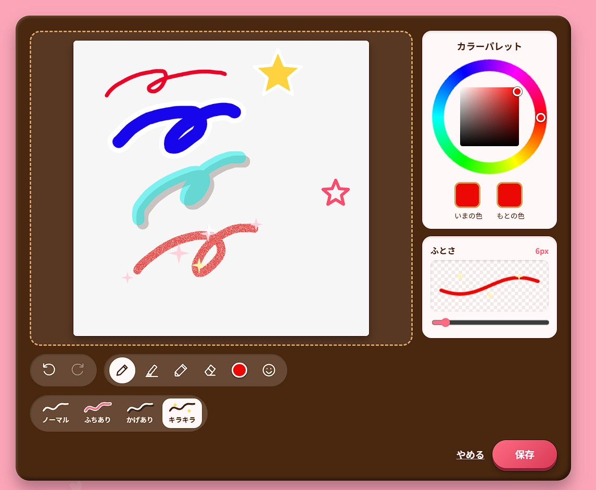

令和8年度 電子情報システム工学実験実習 BII　出席番号 4421　氏名 高野芽楓

# レポート2：Webアプリケーション開発の振り返り（2）

チーム名「美4」、プロダクト名「ピク日記」。本レポートでは、第4回（10/30）と第5回（11/6）の開発を振り返る。第5回までの進捗に加えて、第5回のあと、提出までに進めた作業（11/10）も含めて報告する。リポジトリ上で Claude（生成AI）が書いた部分は、前回と同じく、すべて私が指示し、確認したものである。グループの他のメンバーに Claude を使っている人はいない。

## 1. 前回の計画と実際の進捗の比較・再検討

### 1.1 前回の計画

前回（レポート1）では、第4回以降の計画を次の順で立てていた。最優先は、私の担当である写真への落書き機能である。次に、ほかのメンバーの PC やデータベースを含めて、登録、友達申請、投稿、交換の主要な操作を通しで確かめ、最終発表までに本物のデータが共有される形で動かせるように、公開の方法も検討する。時間が残れば、一日に複数枚の写真を登録し、カレンダーに表示する1枚を選ぶ機能を検討する、というものであった。

### 1.2 計画との差

最優先にしていた落書き機能は、第5回の時点では実装できておらず、計画より遅れていた。第5回（11/6）にリポジトリに入った変更は、日高さんによる交換機能の修正、ホーム画面の修正、投稿画面の作成であった。通しの確認と公開方法の検討も、まだ進んでいなかった。

落書き機能がないと、ワークシートに書いた成功の定義「その日の思い出をかわいい形で保存でき、すぐに見返せること」の「かわいい形」の部分が欠ける。そのため、第5回のあとの11/10に、最優先だった落書き機能から取り組んだ。

### 1.3 実際の進捗と、設計の見直し

第5回（11/6）には、日高さんが、交換機能の仕様を大きく変えた。表1は、その変更の前後である。

| 項目 | 変更前（第3回まで） | 変更後（11/6） |
|---|---|---|
| 交換の仕組み | 自分の投稿を友達に送る。承認されると、相手のカレンダーにその投稿が表示される。 | 申請を承認すると、申請元の投稿と同じ日の自分の投稿とで、写真と日記が入れ替わる。 |
| 入れ替え後 | 送った側は、その投稿が手元から見えなくなる。 | 双方とも、元の内容は見えなくなり、元には戻せない。承認前に確認の表示が出る。 |
| 承認できる条件 | 友達であること。 | 同じ日に自分の未交換の投稿があること。ない場合は承認できない。 |
| データベース | 投稿と、交換申請のテーブル。 | 投稿に「交換した相手」の列を追加。入れ替えは、途中で失敗しないよう、まとめて1回の処理にしている。 |

表1 交換機能の仕様の変更（コミット「交換修正」「交換修正2」から整理）

この表から、前回までは、送る側から受け取る側への一方通行で、お互いが相手の写真を受け取る形にはなっていなかったことが分かる。変更後は、シール帳でシールを交換するように、双方の写真が入れ替わる。一方で、同じ日に自分の投稿がないと承認できないという制約が新しく生まれた。これについては、2.2 で課題として述べる。

同じ日には、ホーム画面の見た目も見直した。写真を拡大して見るとき、「シール帳」というコンセプトなのだから、本のようにページがぺらっとめくれたら楽しいのではないか、とチームで話し合い、可決した。その結果、ホーム画面は、日記の本のページの角を押すと、前の日や次の日にめくれる見た目になった。投稿画面も作り直された。落書き機能は、この新しいホーム画面に、「友達と交換する」ボタンと並べて組み込んだ。

{width=90%}

図1は、11/10に作った落書き画面である。左の枠が描く場所で、ここに写真が表示され、その上に描く。この図では、確認のために、ノーマル、ふちあり、かげあり、キラキラの4種類の線と、星のスタンプを描いている。右側は、色を選ぶカラーパレットと、線の太さを選ぶ「ふとさ」で、「ふとさ」の横には、太さの数値（6px）と、その太さで描いたときの見え方が表示されている。左下には、「もとに戻す」「やり直す」、ペンなどの道具、色、スタンプのボタンと、線の種類の選択が並び、右下に「やめる」と「保存」がある。背景のピンクとチョコ色の枠は、投稿画面と同じ見た目にそろえた。

## 2. 現在の進捗と課題・検討事項

### 2.1 完成していること

ここまでで、前回までに動いていた機能（登録・ログイン、キャラ選択、マイページ、友達の検索・申請・承認、写真と日記の投稿、カレンダー表示）に加えて、次の機能ができた。

交換機能は、前述のとおり、写真と日記が入れ替わる形になった。ホーム画面は、日付ごとにページをめくる本の形になった。落書き機能は、「友達と交換する」ボタンの横の「落書き」ボタンから別の画面に移り、写真の上に描ける。道具は、ペン、マーカー、エンピツ、ケシゴムで、線の種類は、ノーマル、ふちあり、かげあり、キラキラの4つから選べる。スタンプは、星、ハート、花、ニコちゃん、キラキラを、黄・赤・青の3色で用意した。色はカラーパレットで選び、「もとに戻す」「やり直す」もできる。保存すると、投稿の写真が落書きした写真に置き換わる。ワークシートで決めた最低限の4機能（写真の交換、写真のアップ、落書き、写真1つにつき1つの文章）は、すべて動く状態になった（落書きの保存は、実機ではまだ確かめていない）。

### 2.2 完成していないことと、現在の課題

完成していないことは、一日に複数枚の写真を登録し、カレンダーに表示する1枚を選ぶ機能、アルバムの印刷、スマホアプリ化である。これらは、時間に余裕ができたら検討するものとしている。

今週に、みんなの出来を見る鑑賞会があり、それまでに主要な機能を搭載できたことは、良かったと考えている。しかし、使うときの満足感に直結する部分が、まだできていない。

課題は3つある。1つ目は、動作確認の不足である。落書き機能は、画面の操作（線を引く、スタンプを置く、もとに戻す、保存してホームに戻る）までは自動のテストで確かめたが、このときバックエンドと MySQL は動かしておらず、サーバーの応答は仮のものだった。実際のデータベースに保存されるところは、まだ確かめていない。【要確認：その後、自分のPCで確かめたか。確かめた場合は、結果を書く】

2つ目は、保存したあとの取り消しや編集ができないことである。描いている途中の「もとに戻す」「やり直す」はできるが、保存すると、落書きが元の写真を置き換えて、元には戻せない。あとから描き足したり、落書きを消したりもできない。これらは、実際に使うときの満足感に直結する部分である。交換も元に戻せないため、「やり直せない操作」が2つ重なっている。交換済みの投稿には落書きボタンを出さない仕様にしているので、落書きをしてから交換する順番になる。この順番を利用者に分かりやすく示す必要がある。

3つ目は、交換の承認の制約である。同じ日に自分の投稿がないと、申請を承認できない。友達と同じ日に投稿しないと交換できないことになり、「友達と交換して思い出を残す」という使い方を狭めるおそれがある。この制約を残すか、日付をそろえない方法にするかは、まだ決めていない。

## 3. 課題・検討事項への対応とその結果

### 3.1 日記の本が画面からはみ出す問題

11/10に、写真を1枚だけ選んだときに、日記の本が画面からはみ出す問題が見つかった。私が、はみ出した画面のスクリーンショットを Claude に見せて、直すよう頼んだ。Claude は、画面の大きさを私のスクリーンショットに近い幅1270、高さ620にそろえて再現し、原因を3つ見つけた。1つ目は、右側の友達選択の枠が、閉じていても幅320px分の場所を取っていたため、本が左に寄っていたことである。2つ目は、本が縦の中央に置かれていたが、画面の高さより大きかったため、上に111px切れていたことである。3つ目は、本のページの幅の指定（720px）が、縦に並べた中では高さとしても効いてしまい、高さが720pxになっていたことである。

対応として、友達選択の枠が閉じている間は非表示にし、本の高さを、画面の高さに合わせて小さくなるようにした。その結果、本が画面の左右と上下の中央に収まり、「友達と交換する」ボタンも画面内に見えるようになった。変更は、スタイルシートの末尾に追記しただけで、既存の部分は書き換えていない。この確認は、バックエンドを起動せず、サーバーの応答を仮のものにして行った。マージ（PR #29）は、この結果を受けて私が指示した。

### 3.2 落書き・スタンプ機能の実装と、見た目の修正

落書き機能は、私がイメージ画像を渡し、「友達と交換する」ボタンの横に筆の絵の落書きボタンを置いて、押すと別のページで写真に落書きできるようにしてほしい、と頼んだ。背景色やボタンの見た目は、もとのウェブアプリを参考にするよう指示した。シールに落書きできるという観点から、画面も使い心地も、できるだけプリクラに近づけたかったためである。完成後、使ってもらった人から「プリクラみたい！」という意見をもらえた。狙いが伝わった結果であり、大きな成功だったと考えている。

Claude が作った最初の版のスクリーンショットを見て、私は2点を直すよう伝えた。1点目は、エンピツの質感が、マーカーと似ていたことである。私は、できるだけ鉛筆のようにざらざらにするよう頼んだ。Claude は、最初は粒が細かすぎてラメのように見えたため、芯の濃さを残しつつ、紙の目のような粒で線を削るように調整した。その結果、ところどころ紙の白が抜けて、半透明でなめらかなマーカーとは見分けられるようになった。一度描いた線は、「もとに戻す」「やり直す」をしても、同じ模様のまま残る。

2点目は、サイズの表示である。スタンプの大きさを変えるのに、「ふとさ」のスライダーを動かす形になっていたため、スタンプを選んでいる間は「おおきさ」と表示するよう頼んだ。また、「ふとさ」「おおきさ」の横に、どのくらいの大きさになるかを、リアルタイムで表示するよう頼んだ。実際にどのくらいの太さになるのかが、何回も試さないと直感的に分からず、面倒だったためである。Claude は、数値（例：14px、90px）と、見え方のプレビューを足した。ペンとマーカーとエンピツは、選んでいる色と線の種類で、試しの線を描く。ケシゴムは、消える範囲を点線の丸で示す。スタンプは、選んでいるスタンプを、その大きさで表示する。

一方、「ふとさ」のスライダーは、私のイメージ画像にはなかったもので、Claude が、あると便利だと考えて足したものである。太さを調整できる点は良いと考え、そのまま残した。そのうえで、数値とプレビューを足したことで、何回も試さなくても、太さが直感的に分かるようになった。面倒だった点が解決できて、うれしかった。

### 3.3 生成AIの提案を、確認・修正した場面

落書き機能は、Claude が、自動のテストで「描く、保存する、ホームに戻る」までの動作を確かめたと報告した。しかし、Claude は、バックエンドと MySQL は動かしておらず、実際のデータベースに保存されるところは確かめていないことも、あわせて伝えた。この報告から、保存のために新しい API（`PUT /api/posts/:id/photo`）が増えていることと、動かすにはバックエンドの再起動が必要なことが分かった。実機での保存の確認は、今後の計画に入れた（4）。

見た目については、Claude が撮ったスクリーンショットを私が見て、エンピツの質感がマーカーと似ていることに気づき、修正を指示した。自動のテストでは、描画が動くことは確かめられても、質感が鉛筆らしいかは判断できない。この判断は、私が画面を見て行う必要がある。

## 4. 今後の計画

最優先は、今週の鑑賞会までに、自分のPCで実際の MySQL を使って、落書き機能を最後まで通して確かめることである。`main` を取り込み、バックエンドを再起動して、写真を投稿し、落書きして保存し、ホームの本に落書きした写真が出ることを確認する。落書き機能は、自動のテストでしか確かめておらず、保存が実際に動くかが分からないためである。

鑑賞会のあとは、保存したあとの取り消しと編集の機能に取り組む。落書きする前の写真を残しておき、あとから落書きを消したり、描き直したりできるようにしたい。2.2 で述べたとおり、これは使うときの満足感に直結する部分であり、鑑賞会で見てもらった人の意見も、優先順位を決める材料にする。

そのうえで、ほかのメンバーの PC を含めて、主要な操作（登録、友達申請、投稿、落書き、交換）を通しで確かめる。特に、交換は仕様が変わったばかりなので、同じ日に投稿がない場合の承認や、交換したあとの表示を、友達と実際に試す。同じ日に自分の投稿がないと承認できない制約を、残すか変えるかも、この確認の中でチームで決める。最終発表までに、本物のデータが共有される形で動かせるように、公開の方法も検討する。現在は、GitHub Pages ではデモモードで動くだけで、本物の登録やログインは、自分の PC でバックエンドを動かさないと使えない。時間が残れば、一日に複数枚の写真を登録し、カレンダーに表示する1枚を選ぶ機能を検討する。
